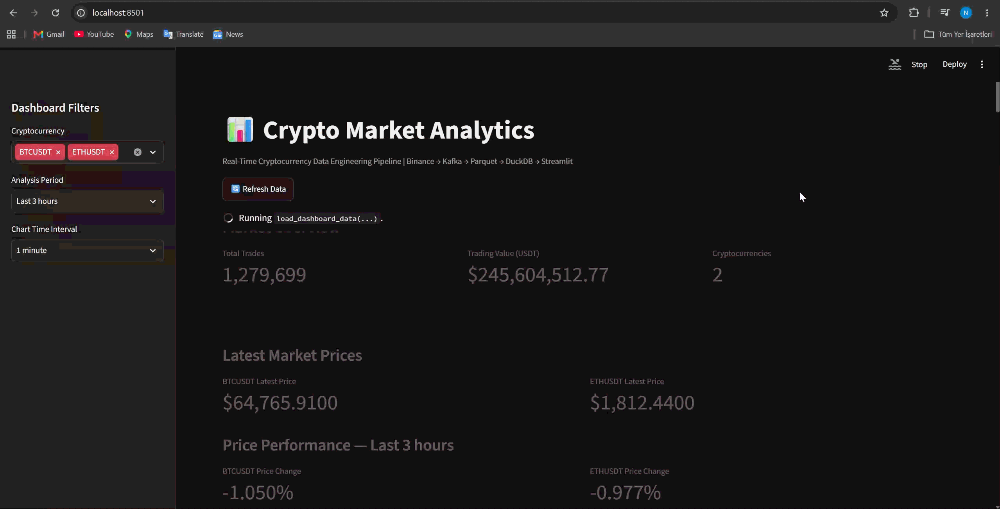
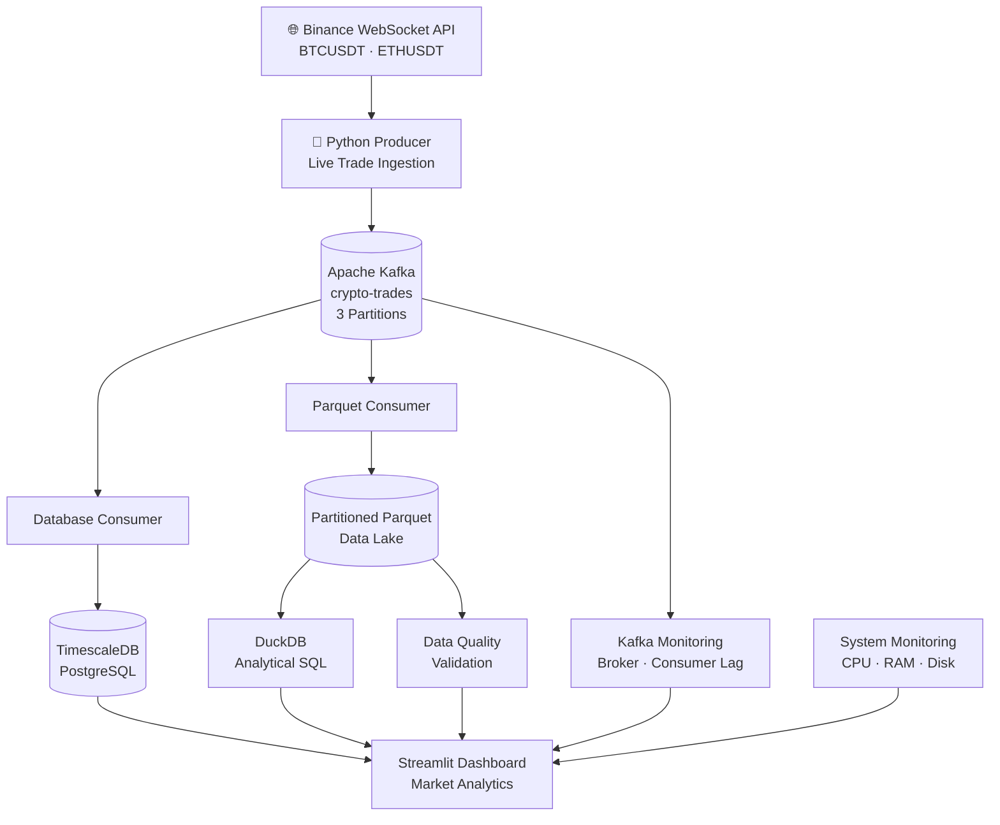
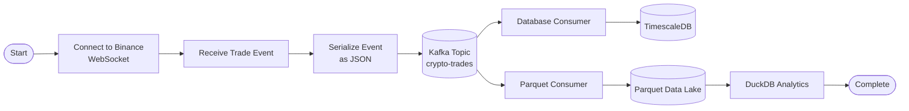
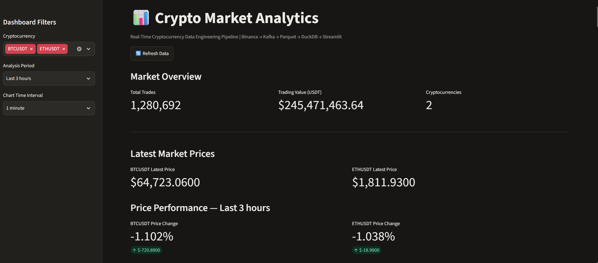
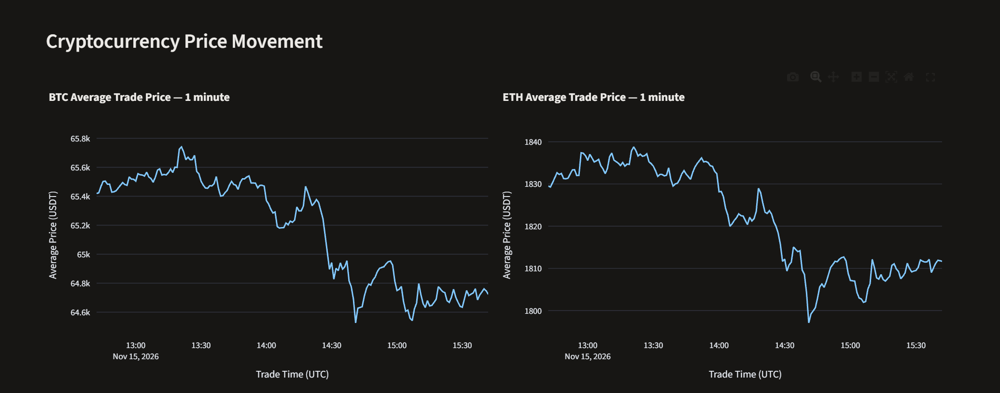
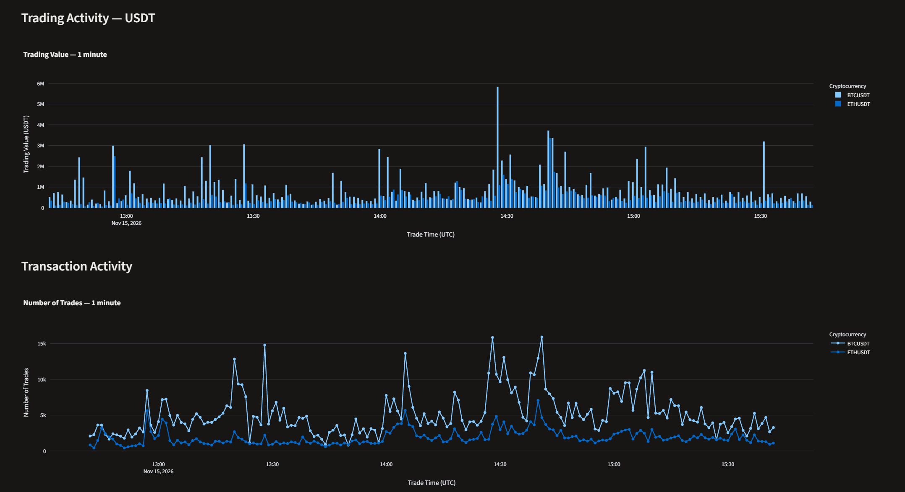
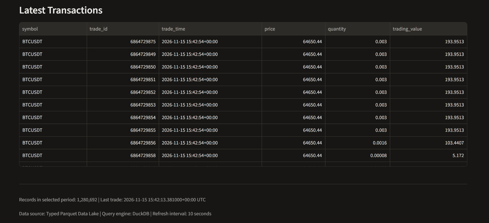
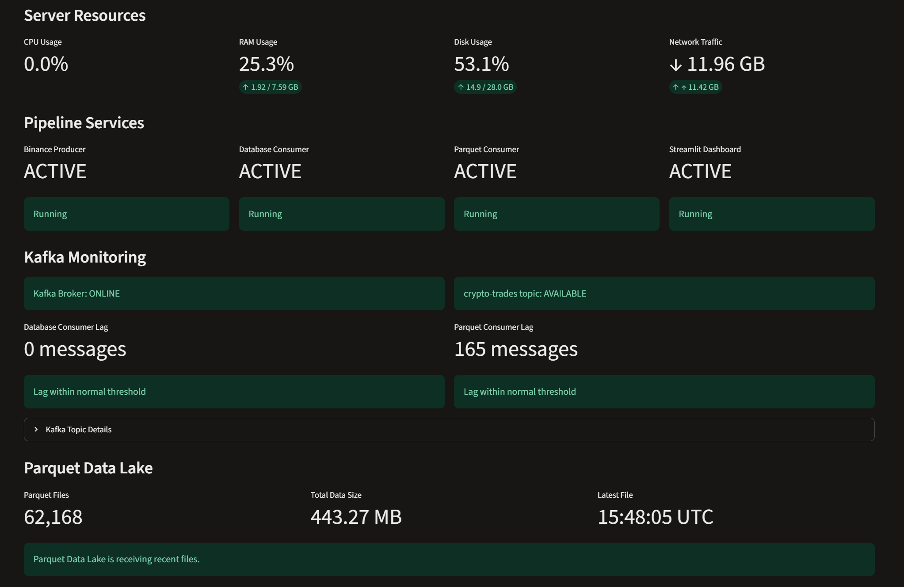
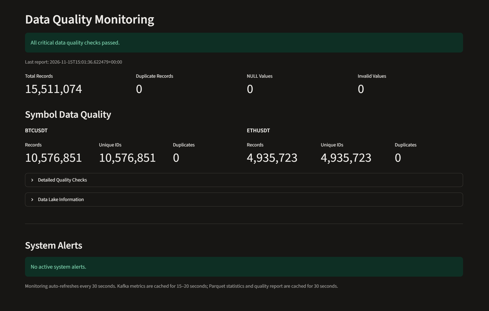
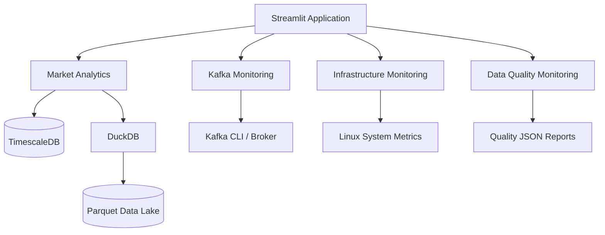

<div align="center">

# ₿ Real-Time Cryptocurrency Data Engineering Pipeline

### Automated Streaming Data Platform & Real-Time Market Analytics

*From live Binance trade streams to a monitored analytical Data Lake: Python → Apache Kafka → TimescaleDB / Parquet → DuckDB → Streamlit*


[Overview](#-overview) •
[Architecture](#-system-architecture) •
[Engineering](#-key-engineering-features) •
[Data Lake](#-data-lake--analytics) •
[Dashboard](#-monitoring--dashboard) •
[Quick Start](#-quick-start) •
[Roadmap](#-roadmap)

</div>

---

## 📑 Table of Contents

- [Overview](#-overview)
- [Project Highlights](#-project-highlights)
- [System Architecture](#-system-architecture)
- [Streaming Pipeline](#-streaming-pipeline)
- [Key Engineering Features](#-key-engineering-features)
- [Data Storage Architecture](#-data-storage-architecture)
- [Data Lake & Analytics](#-data-lake--analytics)
- [Monitoring & Dashboard](#-monitoring--dashboard)
- [Data Quality](#-data-quality)
- [Technology Stack](#-technology-stack)
- [AWS Deployment](#-aws-deployment)
- [Quick Start](#-quick-start)
- [Configuration](#-configuration)
- [Repository Structure](#-repository-structure)
- [Engineering Challenges](#-engineering-challenges)
- [Roadmap](#-roadmap)
- [Security](#-security)
- [Author](#-author)

---

## 🎯 Overview

**Real-Time Cryptocurrency Data Engineering Pipeline** is an end-to-end streaming data engineering project designed to ingest, process, store, validate, and analyze live cryptocurrency market transactions.

The pipeline consumes real-time trade events from the **Binance WebSocket API**, publishes them to **Apache Kafka**, and distributes the incoming data to independent downstream consumers.

Processed market data is stored in two complementary storage systems:

- **TimescaleDB:** Structured relational storage for transactional and time-series analysis.
- **Apache Parquet Data Lake:** Typed, columnar and partitioned storage for analytical workloads.

**DuckDB** provides analytical querying capabilities over Parquet files, while an interactive **Streamlit dashboard** presents market analytics and infrastructure monitoring.

The complete platform is deployed on an **AWS EC2 Ubuntu instance**, with Docker Compose managing infrastructure and systemd managing application services.

The project focuses not only on data ingestion and transformation, but also on operational reliability, fault recovery, data quality, monitoring, and persistent storage.

---

## 🎬 Live Dashboard Demo



---

## 📌 Project Highlights

| Component | Implementation |
|---|---|
| Data Source | Binance WebSocket API |
| Market Symbols | BTCUSDT, ETHUSDT |
| Streaming Platform | Apache Kafka 3.8.0 |
| Kafka Architecture | KRaft mode |
| Kafka Topic | `crypto-trades` |
| Topic Partitions | 3 |
| Database | PostgreSQL / TimescaleDB |
| Data Lake | Apache Parquet |
| Analytical Engine | DuckDB |
| Dashboard | Streamlit + Plotly |
| Infrastructure | AWS EC2 Ubuntu |
| Containerization | Docker Compose |
| Process Management | Linux systemd |
| Data Validation | Automated Python quality checks |

### Main Capabilities

- Continuous real-time cryptocurrency trade ingestion.
- Event streaming through a multi-partition Kafka topic.
- Independent database and Parquet consumers.
- Structured and columnar data storage.
- Analytical SQL queries using DuckDB.
- Automated data quality validation.
- Consumer lag and Kafka broker monitoring.
- Infrastructure resource monitoring.
- Automatic service startup after server reboot.
- Persistent Kafka storage and consumer recovery.

---

## 🏗️ System Architecture

The platform follows an event-driven architecture in which Kafka acts as the central streaming layer.



### Architecture Layers

| Layer | Responsibility |
|---|---|
| Ingestion | Receives live market trades from Binance |
| Streaming | Buffers and distributes events through Kafka |
| Processing | Independent consumers process incoming events |
| Storage | Stores data in TimescaleDB and Parquet |
| Analytics | Executes analytical queries with DuckDB |
| Quality | Validates data integrity and consistency |
| Presentation | Displays market and infrastructure metrics |
| Operations | Manages services, recovery and scheduled checks |

---

## ⚙️ Streaming Pipeline

The streaming architecture separates ingestion from downstream processing.



### Pipeline Execution

**1. Data Ingestion**

The Python producer connects to Binance WebSocket streams and continuously receives trade events.

**2. Event Streaming**

Incoming events are serialized into JSON and published to the Kafka topic `crypto-trades`.

**3. Database Processing**

A dedicated Kafka consumer processes trade events and inserts structured records into TimescaleDB.

**4. Data Lake Processing**

A separate consumer processes the same Kafka topic and writes typed Parquet data to the Data Lake.

**5. Analytics**

DuckDB queries Parquet files directly, enabling analytical operations without loading the entire dataset into memory.

**6. Monitoring and Validation**

The dashboard monitors pipeline health, consumer lag, infrastructure resources and automated data quality reports.

---

## 🌟 Key Engineering Features

<table>
<tr>
<td width="50%" valign="top">

### 🔄 Independent Kafka Consumers

Two separate consumer applications process the same Kafka topic:

- Database consumer
- Parquet consumer

Each consumer group maintains its own processing progress, allowing downstream workloads to operate independently.

</td>
<td width="50%" valign="top">

### 🗄️ Dual Storage Architecture

The project uses two complementary storage systems:

- TimescaleDB for structured time-series data.
- Parquet for analytical Data Lake storage.

This separates operational storage from analytical processing.

</td>
</tr>

<tr>
<td width="50%" valign="top">

### 📦 Columnar Data Processing

Parquet provides typed, columnar storage suitable for analytical workloads.

The Data Lake uses partitioned storage to organize market data and support efficient querying.

</td>
<td width="50%" valign="top">

### ⚡ Analytical SQL with DuckDB

DuckDB enables direct SQL analytics over Parquet datasets.

This avoids the need to import the complete Data Lake into a traditional database before running analytical queries.

</td>
</tr>

<tr>
<td width="50%" valign="top">

### 🛡️ Automated Recovery

Linux systemd manages the producer, consumers and dashboard.

Services are configured to start automatically and recover after process or infrastructure restarts.

</td>
<td width="50%" valign="top">

### 🔍 Data Quality Automation

Scheduled validation checks inspect incoming analytical data.

Quality reports are generated in JSON format and made available to the monitoring dashboard.

</td>
</tr>
</table>

---

## 🗄️ Data Storage Architecture

The pipeline maintains two independent storage destinations.

### 1. TimescaleDB

TimescaleDB is used for structured trade storage and relational querying.

The database consumer continuously reads events from Kafka and writes them to the database.

**Main responsibilities:**

- Structured trade records.
- Time-series data storage.
- SQL-based querying.
- Downstream analytical access.

### 2. Apache Parquet Data Lake

The Parquet consumer writes incoming trade events into a columnar storage format.

**Main responsibilities:**

- Persistent analytical data storage.
- Typed columnar datasets.
- Partitioned file organization.
- Efficient analytical scans.

The Data Lake is kept separate from the Git repository. Generated data files are not committed to GitHub.

---

## 📊 Data Lake & Analytics

The project uses **Apache Parquet and DuckDB** as its analytical storage and query layer.

### Why Parquet?

- Columnar storage format.
- Efficient analytical scans.
- Typed data representation.
- Compression support.
- Suitable for large-scale analytical workloads.

### Why DuckDB?

DuckDB provides an embedded analytical SQL engine capable of querying Parquet files directly.

This makes it possible to perform analytical operations without maintaining another continuously running analytical database.

Example analytical query:

```sql
SELECT
    symbol,
    COUNT(*) AS total_trades,
    ROUND(AVG(price), 4) AS average_price,
    ROUND(MIN(price), 4) AS minimum_price,
    ROUND(MAX(price), 4) AS maximum_price,
    ROUND(SUM(quantity), 6) AS total_quantity
FROM read_parquet('data/parquet/**/*.parquet')
GROUP BY symbol
ORDER BY total_trades DESC;
```

*The example illustrates the analytical approach; adjust the Parquet path and column names if your local dataset uses a different schema.*

---

## 📈 Monitoring & Dashboard

The Streamlit application provides a unified interface for market analytics and pipeline observability.

### Market Analytics

- Live BTCUSDT and ETHUSDT market overview.
- Latest market prices.
- Price performance.
- Trading activity.
- Latest transaction records.
- Historical analytical views.

### Infrastructure Monitoring

- CPU utilization.
- Memory utilization.
- Disk usage.
- Network statistics.
- Linux service status.
- Kafka broker availability.
- Kafka topic information.
- Consumer group monitoring.
- Consumer lag.
- Parquet Data Lake statistics.
- Data quality status.
- System alerts.

### Dashboard Screenshots

#### 1. Dashboard Overview



#### 2. BTC & ETH Price Analytics



#### 3. Trading & Transaction Activity



#### 4. Latest Transactions



#### 5. Infrastructure Monitoring



#### 6. Data Quality Monitoring



---

### Dashboard Architecture



The dashboard is deployed as a managed systemd service and listens locally on port `8501`.

---

## 🧪 Data Quality

An automated quality validation process checks the integrity of the Data Lake.

The validation process includes:

| Check | Purpose |
|---|---|
| Null validation | Detects missing critical values |
| Duplicate validation | Identifies duplicate trade records |
| Price validation | Detects invalid prices |
| Quantity validation | Detects invalid trade quantities |
| Symbol validation | Checks expected market symbols |
| Timestamp validation | Identifies invalid or future timestamps |
| Data availability | Checks expected market data coverage |

### Quality Reports

Validation results are written to:

```text
data/quality/latest_report.json
```

A systemd timer periodically triggers the quality validation service.

The dashboard reads the latest report and displays its status.

---

## 🧰 Technology Stack

| Layer | Technology |
|---|---|
| Programming Language | Python 3.12 |
| Data Source | Binance WebSocket API |
| Streaming Platform | Apache Kafka 3.8.0 |
| Kafka Architecture | KRaft |
| Database | PostgreSQL / TimescaleDB |
| Data Lake | Apache Parquet |
| Columnar Processing | PyArrow |
| Analytical Engine | DuckDB |
| Data Manipulation | Pandas |
| Dashboard | Streamlit |
| Visualization | Plotly |
| Infrastructure | AWS EC2 |
| Operating System | Ubuntu Linux |
| Containerization | Docker |
| Container Orchestration | Docker Compose |
| Process Management | systemd |
| Version Control | Git / GitHub |

---

## ☁️ AWS Deployment

The project is deployed on an Ubuntu-based AWS EC2 instance.

### Infrastructure Components

| Component | Deployment |
|---|---|
| Operating System | Ubuntu |
| Compute | AWS EC2 |
| Kafka | Docker container |
| Kafka UI | Docker container |
| TimescaleDB | Docker container |
| Producer | systemd service |
| Database Consumer | systemd service |
| Parquet Consumer | systemd service |
| Streamlit Dashboard | systemd service |
| Quality Checks | systemd timer |

### Service Management

The following systemd services manage the application:

```bash
# Producer
sudo systemctl status crypto-producer

# Database consumer
sudo systemctl status crypto-db-consumer

# Parquet consumer
sudo systemctl status crypto-parquet-consumer

# Streamlit dashboard
sudo systemctl status crypto-dashboard

# Data quality timer
sudo systemctl status crypto-quality.timer
```

### Infrastructure Management

```bash
# Docker containers
docker compose ps

# Kafka consumer groups
docker exec kafka /opt/kafka/bin/kafka-consumer-groups.sh \
  --bootstrap-server kafka:9092 \
  --all-groups \
  --describe

# Recent producer logs
sudo journalctl -u crypto-producer -n 50 --no-pager

# Recent database consumer logs
sudo journalctl -u crypto-db-consumer -n 50 --no-pager

# Recent Parquet consumer logs
sudo journalctl -u crypto-parquet-consumer -n 50 --no-pager
```

### Remote Dashboard Access

The dashboard is bound to localhost on the EC2 instance.

Use SSH port forwarding to access it securely from your local computer:

```bash
ssh -i "your-ec2-key.pem" \
  -L 8501:127.0.0.1:8501 \
  ubuntu@YOUR_EC2_PUBLIC_IP
```

Then open:

```text
http://localhost:8501
```

Kafka UI and database ports are also bound to localhost in the deployment configuration.

---

## 🚀 Quick Start

### Prerequisites

- Python 3.12+
- Docker
- Docker Compose
- Git
- Binance WebSocket connectivity

### 1. Clone the Repository

```bash
git clone https://github.com/nihatrza/realtime-crypto-pipeline.git

cd realtime-crypto-pipeline
```

### 2. Configure Environment Variables

Create a local environment file:

```bash
cp .env.example .env
```

Edit `.env`:

```env
POSTGRES_PASSWORD=your_secure_password
```

Use a secure password of your own. Never commit `.env` to GitHub.

### 3. Start Infrastructure

```bash
docker compose up -d
```

Verify the containers:

```bash
docker compose ps
```

### 4. Create a Python Virtual Environment

```bash
python3 -m venv .venv

source .venv/bin/activate

pip install -r requirements.txt
```

### 5. Start the Dashboard

```bash
streamlit run src/dashboard/app.py
```

The dashboard is configured for local access on port `8501`.

> The complete production deployment also uses systemd-managed producer and consumer services. Review the service configurations and environment variables before running individual components manually.

---

## 🔧 Configuration

| Configuration | Location | Description |
|---|---|---|
| PostgreSQL password | `.env` | Database authentication |
| Environment template | `.env.example` | Required environment variable template |
| Docker services | `docker-compose.yml` | Kafka, Kafka UI and TimescaleDB |
| Python dependencies | `requirements.txt` | Application dependencies |
| Database schema | `sql/01_create_crypto_trades.sql` | Trade storage schema |
| Kafka topic | `crypto-trades` | Streaming topic |
| Producer | `src/producer/binance_producer.py` | Binance ingestion |
| Database consumer | `src/consumer/kafka_consumer.py` | TimescaleDB ingestion |
| Parquet consumer | `src/parquet/kafka_to_parquet.py` | Data Lake ingestion |
| Quality checks | `src/parquet/quality_checks.py` | Data validation |
| Analytics | `src/parquet/analyze_parquet.py` | Parquet analysis |
| Dashboard | `src/dashboard/app.py` | Streamlit application |

---

## 📁 Repository Structure

```text
realtime-crypto-pipeline/
│
├── src/
│   ├── producer/
│   │   └── binance_producer.py
│   │
│   ├── consumer/
│   │   └── kafka_consumer.py
│   │
│   ├── parquet/
│   │   ├── kafka_to_parquet.py
│   │   ├── quality_checks.py
│   │   └── analyze_parquet.py
│   │
│   ├── analytics/
│   │   ├── __init__.py
│   │   └── duckdb_test.py
│   │
│   └── dashboard/
│       └── app.py
│
├── sql/
│   └── 01_create_crypto_trades.sql
│
├── .env.example
├── .gitignore
├── docker-compose.yml
├── requirements.txt
├── LICENSE
└── README.md
```

---

## 🧩 Engineering Challenges & Solutions

| Challenge | Engineering Approach |
|---|---|
| Continuous market data ingestion | Persistent Binance WebSocket producer |
| Multiple downstream processing requirements | Independent Kafka consumer groups |
| Kafka data persistence | Docker named volumes |
| Consumer recovery | systemd-managed application services |
| Infrastructure reboot | Automatic service startup and recovery |
| Database credential management | Environment variables and protected `.env` file |
| Analytical storage efficiency | Typed, partitioned Parquet Data Lake |
| Large-scale analytical queries | DuckDB direct Parquet querying |
| Pipeline observability | Kafka consumer lag and service monitoring |
| Data integrity | Scheduled automated quality checks |

### Reliability and Recovery

The deployed pipeline has been tested for:

- Producer and consumer service restarts.
- Kafka persistence across EC2 reboot.
- Automatic service startup after reboot.
- Consumer recovery after Kafka becomes available.
- Consumer lag recovery.
- Database connectivity recovery.
- Continued Parquet data ingestion.
- Scheduled data quality execution.

---

## 🗺️ Roadmap

- [x] Binance WebSocket real-time ingestion
- [x] Python Kafka producer
- [x] Apache Kafka KRaft deployment
- [x] Three-partition Kafka topic
- [x] Independent database consumer
- [x] Independent Parquet consumer
- [x] TimescaleDB integration
- [x] Partitioned Parquet Data Lake
- [x] DuckDB analytical layer
- [x] Streamlit market dashboard
- [x] Infrastructure monitoring
- [x] Kafka consumer lag monitoring
- [x] Automated data quality validation
- [x] systemd service management
- [x] Persistent Kafka storage
- [x] EC2 reboot and recovery testing
- [x] GitHub repository and project documentation
- [ ] Parquet file compaction and optimization
- [ ] Advanced automated integration testing
- [ ] Historical market analytics enhancements
- [ ] Additional cryptocurrency trading pairs
- [ ] Automated alert delivery
- [ ] CI/CD with GitHub Actions
- [ ] Cloud-based analytical warehouse integration

---

## 🔒 Security

Security practices implemented in the project:

- Credentials are stored in environment variables.
- `.env` is excluded from Git.
- `.env.example` contains only placeholder configuration.
- Python virtual environments are excluded from Git.
- Generated Parquet datasets and local data are excluded from Git.
- Backup files are excluded from Git.
- Database and infrastructure ports are bound to localhost in the EC2 deployment.
- SSH is used for secure remote server access.
- GitHub authentication uses an SSH key.

**Never commit:**

- Database passwords.
- Private SSH keys.
- AWS credentials.
- API keys or access tokens.
- Private configuration files.
- Generated datasets containing non-public information.

---

## 👤 Author

**Nihat Rzaquluzada**

Aspiring Data Engineer | Information Technology Student

Focused on building data engineering solutions involving:

- Python
- SQL
- Apache Kafka
- Apache Spark
- Data Pipelines
- Data Warehousing
- Cloud Infrastructure
- Data Analytics

[](https://github.com/nihatrza)

[](https://www.linkedin.com/in/nihat-rzaguluzada/)

---

<div align="center">

**Built with Python, Kafka, and a passion for Data Engineering.**

⭐ If you find this project interesting, consider giving it a star!

</div>
